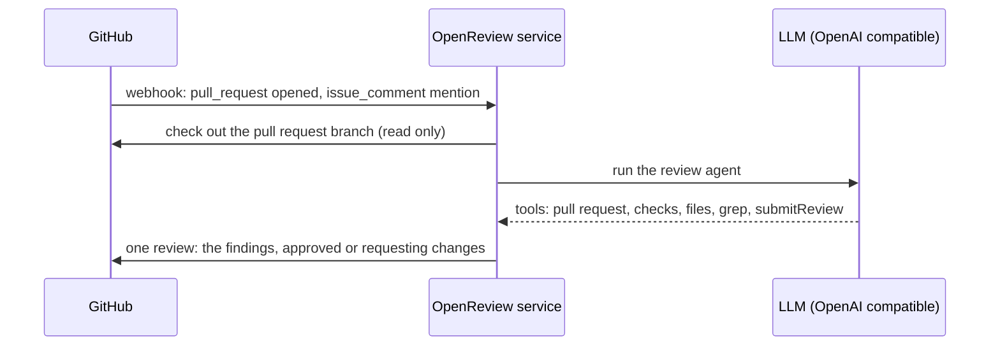

# OpenReview

An AI code review bot for GitHub pull requests. This is a fork of
[vercel-labs/openreview](https://github.com/vercel-labs/openreview) that runs as a
plain Node service in a container instead of on Vercel.

- **No serverless platform** — one `node dist/server.js` process behind an ingress.
- **Read-only** — the reviewed branch is checked out and read; the agent has no shell, no
  package manager and no build tooling, so nothing from the pull request is ever executed.
- **Any OpenAI-compatible model** — point `LLM_BASE_URL` at your own gateway.
- **Automatic reviews** — new and updated pull requests are reviewed without a mention.
- **Automatic approval** — a pull request is approved when the review does not request changes.

## How it works



The agent reads the diff, the CI results and the surrounding code, and publishes with the
`submitReview` tool; the pipeline submits exactly one review carrying that text, so a pull
request never gets both a comment and a review for the same run.

Triggers:

1. `pull_request` — `opened`, `reopened`, `ready_for_review`, `synchronize`.
2. `issue_comment` — mentioning the bot, for example `@openreview review the error handling`.
3. `pull_request_review_comment` — mentioning the bot inside an inline review thread.

Events raised by the app itself are ignored, so the commit the agent pushes does not
start another review.

Closed and merged pull requests are ignored everywhere: a mention on one is dropped
before anything is read or reacted to, and a review that is already queued is dropped
when the pull request turns out to be closed. A revision is reviewed once — triggers
raised together (a mention also raises a `pull_request` event) collapse, and an
identical review is never posted twice.

Authorisation, because every review costs tokens:

- A mention only starts a review when the comment author is a member of the organization
  that owns the repository (`author_association` is `OWNER` or `MEMBER`, configurable
  with `TRUSTED_ASSOCIATIONS`). Outside collaborators (`COLLABORATOR`) are not members
  and are ignored. Mentions from everyone else are logged and ignored, which matters when
  the repository is public.
- Automatic reviews run only when the pull request author is an organization member or a
  trusted automation bot from `AUTO_REVIEW_BOTS` (default: `dependabot[bot]`,
  `renovate[bot]`). A member can still ask for a review of somebody else's pull request
  by mentioning the bot.
- Pull requests from forks are skipped (`REVIEW_FORK_PRS=false`): a fork can only be
  pushed to by its owner. Pull requests for branches in the repository itself, including
  bot branches such as dependabot's, are reviewed as usual.
- Replies without a mention do not trigger anything: the bot only acts on comments that
  mention it. A reply inside an inline review thread works when it mentions the bot.

## Multiple organizations

One deployment serves several organizations, each with its own private GitHub App,
without per-organization processes or domains:

- A tenant registry in the deployment configuration repository lists every app: a
  route key, the organization, app id, installation id, bot slug, and the names of the
  environment variables that hold that tenant's private key and webhook secret. In
  preprod the registry is `tenants.json` in the OpenReview overlay and reaches the
  service as `TENANTS_JSON`; the secrets themselves stay in Vault.
- Every tenant answers on `POST /webhook/<key>`; the first registry entry also owns
  the legacy `POST /webhook`. A delivery is verified with the target tenant's webhook
  secret, and an event whose repository owner is not that tenant's organization is
  ignored.
- Each tenant gets its own chat adapter, installation token and review context, while
  reviews keep running through the shared serial queue.

Adding an organization: create a private GitHub App with the permissions and events
below, install it on the organization, point its webhook at
`https://<host>/webhook/<key>`, store the private key and webhook secret in Vault,
add the matching environment variables and a `tenants.json` entry in the
configuration repository, and let ArgoCD sync. No code change, no image rebuild and no
kubectl access is required; the registry content hash rolls the Deployment.

Approval rules:

- The agent calls `requestChanges` when it finds a critical problem, and the review is
  then submitted as a change request.
- Otherwise the review is submitted as an approval (`AUTO_APPROVE=true`, the default) or
  as a plain comment (`AUTO_APPROVE=false`).
- Drafts and closed pull requests are skipped; in that case the findings are posted as a
  comment so nothing is lost.
- A review with no text at all is never submitted: an agent that reported nothing is not a
  reason to approve.
- The same revision is reviewed once. Triggers raised together for one pull request (a
  mention also raises a `pull_request` event) collapse, and an identical review is never
  posted twice; a new commit still gets its own review.
- A pull request that is already approved is not approved twice. A change request made
  during the same run is never followed by an approval, while a change request from an
  earlier run does not block the next review from approving.

## Local development

```bash
npm install
cp .env.example .env   # fill in the values
npm run dev            # builds and starts on http://127.0.0.1:8090
```

`npm run build` bundles everything into `dist/server.js`; the deployed host needs no
`node_modules`. `npm run typecheck` runs `tsc`.

## Environment

| Variable | Required | Description |
| --- | --- | --- |
| `TENANTS_JSON` | no | Multi-tenant registry (JSON array); when set it takes precedence over the `GITHUB_APP_*` credentials |
| `GITHUB_APP_ID` | legacy | GitHub App id (single-tenant mode) |
| `GITHUB_APP_INSTALLATION_ID` | legacy | Installation id on the target account |
| `GITHUB_APP_PRIVATE_KEY` | legacy | PEM private key (`\n` for newlines) |
| `GITHUB_APP_WEBHOOK_SECRET` | legacy | Webhook secret |
| `GITHUB_ORG` | no | Organization for the legacy single-tenant mode |
| `LLM_BASE_URL` | yes | OpenAI-compatible base URL, including `/v1` |
| `LLM_API_KEY` | yes | API key for that endpoint |
| `LLM_MODEL` | yes | Model name |
| `AUTO_APPROVE` | no | Approve when no review requested changes (default `true`) |
| `TRUSTED_ASSOCIATIONS` | no | `author_association` values allowed to start a review by mentioning the bot (default `OWNER,MEMBER`) |
| `AUTO_REVIEW_BOTS` | no | Bot logins allowed to trigger automatic reviews without organization membership (default `dependabot[bot],renovate[bot]`) |
| `REVIEW_FORK_PRS` | no | Review pull requests from forks (default `false`) |
| `WORKSPACE_ROOT` | no | Where pull request branches are checked out (default `workspaces`) |
| `HOST` / `PORT` | no | Listen address (default `127.0.0.1:8090`) |
| `LOG_LEVEL` | no | `debug`, `info`, `warn`, `error` (default `info`) |
| `MAX_AGENT_STEPS` | no | Tool loop budget (default `12`) |
| `RUN_TIMEOUT_MS` | no | Limit for one review (default `1800000`) |

## Deploy

The service serves `POST /webhook` and `POST /webhook/<tenant>` and `GET /healthz`.

The included `Dockerfile` builds the bundle and copies it together with `.agents/skills`
into a Node 20 image that also contains `git` (needed for the read-only checkout):

```bash
docker build -t openreview .
docker run --env-file .env -p 8090:8090 openreview
```

On Kubernetes, run **one replica** with the `Recreate` strategy. Queued reviews and
deduplication live in memory, so two replicas would review the same revision twice and
split the queue between pods. Give the container CPU and memory limits and a writable
`WORKSPACE_ROOT` (an `emptyDir` is enough; it only holds temporary checkouts).

Terminate TLS at the ingress and point the GitHub App webhook to
`https://<host>/webhook`, content type `application/json`. The preprod deployment is
managed by ArgoCD from the deployment configuration repository; the image tag is pinned
in its OpenReview overlay.

## GitHub App

Repository permissions: **Contents** read and write, **Issues** read and write,
**Pull requests** read and write, **Metadata** read-only. The service only reads
contents; write access to contents is not required.

Events: **Issue comment**, **Pull request**, **Pull request review comment**.

Webhook URL: `https://<host>/webhook/<tenant>` (or `https://<host>/webhook` for the
first registry entry), content type `application/json`. In multi-tenant mode each
organization gets its own private app, installed only on that organization.

## Security

- The service never executes anything from a pull request. There is no shell tool, no
  dependency installation and no build step: the branch is checked out read-only
  (`git clone`, hooks disabled, and it is the only subprocess the service starts) and the
  agent's tools only read files or query the GitHub API. This is enforced by the shape of
  the tool set, not by prompting.
- The service cannot modify pull requests beyond reviewing them: findings are submitted
  as a review, and no code is ever pushed to a branch.
- Reviews are serialised — one checkout and one agent run at a time.
- Each run gets its own temporary directory with mode `0700`, removed when the review
  finishes. Stale directories are cleaned up on startup.
- The installation token is only used to check the branch out and to call the API.
- The container runs as a non-root user and should be given CPU and memory limits so a
  runaway review cannot starve the node.

## Differences from upstream

- Next.js, Vercel Workflow, Vercel Sandbox, the Upstash Redis state adapter and the demo
  web UI are gone. The review pipeline is a plain async function queue in `review/`.
- The agent is an AI SDK `ToolLoopAgent` against an OpenAI-compatible endpoint instead of
  a Claude model through the AI Gateway.
- The agent runs no code: upstream gave it a sandboxed shell, a file writer and the `gh`
  CLI. Here it gets pull request, check, file-list, file-read and grep tools instead, so
  installs, builds and pushes are impossible rather than merely discouraged.
- `pull_request` events are handled directly in `lib/bot.ts`, since the GitHub chat
  adapter only receives comments, and `review/submit-review.ts` submits the single
  review with the verdict.
- Skills are read from `.agents/skills` next to the service, as upstream does.

## Known limitations

- The agent cannot run the linter, the tests or a build; it reads the code and the CI
  results instead. Findings that would need execution are reported as such.
- Reviews are bounded rather than exhaustive: reads are capped (40k characters per file,
  60k for the changed patches), the tool budget is 12 steps with a wrap-up prompt four
  steps before the limit, and a single step may output 2.5k tokens. A review of a large
  pull request therefore reports what the agent reached within that budget. Measured on a
  six-file pull request: 150s, against 600s+ before the bounds.
- GitHub does not deliver reaction webhooks, so reacting to a comment cannot trigger
  anything. Upstream's 👍/❤️ handlers are inert here for the same reason.
- One process handles reviews sequentially; a restart drops queued reviews.
- No review dashboard or streamed progress: results are posted on the pull request.

## License

MIT
